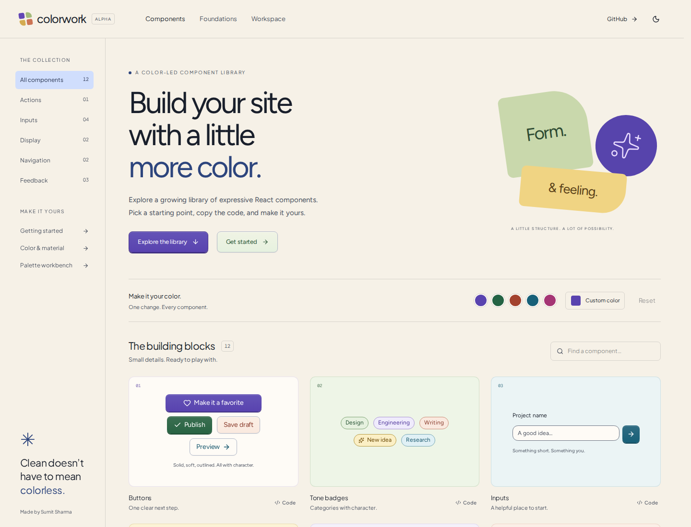

# Colorwork

Build your site with a little more color.

An evolving React component library by Sumit Sharma. Expressive component tones, opaque surfaces, paired light/dark themes, interactive examples and copyable usage code. **Working name; availability unchecked. Alpha, not a stable release.**

Built on Solid Glass, shadcn/ui and Base UI. Original LICENSE and NOTICE.md are retained.



## Run

Use Node 22.12+ (CI uses Node 22).

```bash
npm ci
npm run dev
```

Open http://localhost:5191. The homepage contains the component collection; `/docs/installation` explains copy-in setup and branch-pinned registry commands. `/color-study` keeps the earlier palette workbench; `/view/agent-workspace` is the local-state demo screen.

## Check and build

```bash
npm run docs
npm run typecheck
node --test scripts/block-metadata.test.mjs
npm run build
npm run preview
```

Stop dev before preview; both use port 5191. Build output is `dist/`. Use a static host with SPA fallback for nested routes. GitHub Pages is configured for `https://sumitttt4.github.io/solid-glass`, but is not live until enabled and deployed. `SOLID_GLASS_BASE` and `SOLID_GLASS_ORIGIN` remain as compatible environment variable names for other hosts.

## Reuse

Copy `src/colorwork.css` and `src/solid-glass.css` together; import colorwork.css after your Tailwind/shadcn styles. The source uses React 19, Tailwind 4, Base UI with Figtree and Plus Jakarta Sans. Copy TSX plus helpers/dependencies when using the new ToneBadge and ColorSurface components.

Current branch registry (until merged):

```bash
npx shadcn@latest add sumitttt4/solid-glass/colorwork#color-language
npx shadcn@latest add sumitttt4/solid-glass/tone-badge#color-language
```

Do not use the upstream install command for this theme. See the installation docs for current compatibility limits. Demo actions run in memory; they do not imply a working backend.

## Provenance

Derived from [deeplethe/solid-glass](https://github.com/deeplethe/solid-glass) under MIT; upstream shadcn material is covered by NOTICE.md. Original theme, catalog and color components are additions to that foundation. Keep all relevant notices with redistributed source.
