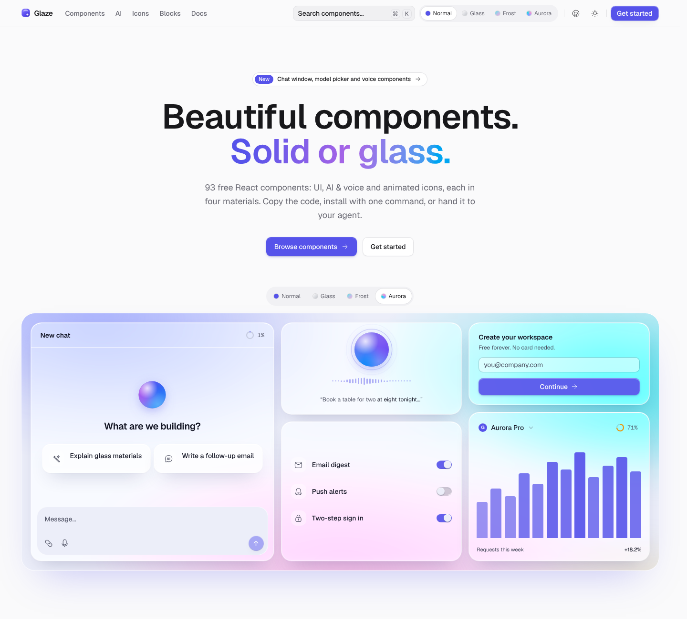

# Glaze

**React components, solid or glass.** · [glazeui.xyz](https://glazeui.xyz)

Glaze is a free React component library by [Sumit Sharma](https://sumitsharma.pro): interface components, AI and voice components, and animated icons, designed together and each available in four finishes. Copy a component, install it with one command, or hand it to your coding agent. No pro tier. **Alpha.**



## What's inside

- **UI components:** buttons, forms, overlays, menus, data and navigation, restyled with one color system and one typeface (Manrope), plus originals: Tone Badge, Color Surface, Palette Picker, Option Card, Status Callout and Copy Snippet.
- **AI and voice:** Chat Window, Model Picker, Prompt Suggestions, Token Counter, Voice Orb, Live Transcript (in-browser speech to text), Voice Input, Audio Waveform, Streaming Text and Speak Button (text to speech), plus agent UI such as Composer, Reasoning and Tool Steps.
- **Animated icons:** 65 icons built on [Hugeicons](https://github.com/hugeicons): a dashboard set of 26 (charts grow, filters slide, tiles pop in) and an everyday set of 39 (bells ring, bins open, two-state copy, menu, theme, mic and play). `AnimatedIcon` animates any Hugeicon with 18 presets.
- **Blocks:** whole screens, such as dashboards, sign-in pages and an agent workspace.
- **Four finishes:** `data-material="solid" | "glass" | "frost" | "aurora"` on `<html>` or on any element.

## Install

In a project set up with `npx shadcn@latest init` (React 19, Tailwind CSS 4):

```bash
npx shadcn@latest add sumitttt4/glazeui/glaze#main         # the theme and four finishes, once
npx shadcn@latest add sumitttt4/glazeui/chat-window#main   # then any component, by name
```

Import the theme after Tailwind:

```css
@import "tailwindcss";
@import "tw-animate-css";
@import "shadcn/tailwind.css";
@import "@fontsource-variable/manrope";
@import "./glaze.css";
@import "./materials.css";
```

Every component page on [glazeui.xyz/components](https://glazeui.xyz/components) has its install command and full source to copy.

## Use with a coding agent

- **Any agent:** point it at [glazeui.xyz/llms.txt](https://glazeui.xyz/llms.txt), a plain-text list of every component with its install command.
- **Agent skill:** `npx skills add sumitttt4/glazeui` installs the Glaze skill from [`skills/glaze`](skills/glaze/SKILL.md), which teaches the agent to install the theme, pick components and set finishes. For Claude Code you can also copy that folder into `.claude/skills/`.

## Run locally

Node 22.12+.

```bash
git clone https://github.com/sumitttt4/glazeui.git
cd glazeui
npm ci
npm run dev        # http://localhost:5191
npm run typecheck
npm run build      # static site in dist/
```

## Deploy

The site is static. `npm run build` writes `dist/`, including the registry at `dist/r/` and `dist/llms.txt`.

- **Cloudflare Workers:** `npx wrangler deploy` uses [`wrangler.jsonc`](wrangler.jsonc), which serves `dist/` and falls back to `index.html` for client-side routes.
- **Cloudflare Pages:** build command `npm run build`, output directory `dist`.

## Color, type and motion

- **Color:** named after ceramic glazes. Porcelain `#F3F5F7` in light mode and pure black `#000000` in dark, Ink `#15171C` text, Cobalt `#2445E6` as the signature, Celadon `#8FC9B6` as its partner and Oxblood `#B42318` for destructive actions. Five tones for categories (`iris`, `fern`, `clay`, `sun`, `ocean`). Set your own accent from the palette picker, or with `data-accent` and `--accent-solid` on `<html>`.
- **Type:** Manrope throughout: regular for reading, medium and semibold for controls and headings.
- **Motion:** custom ease-out curves, popovers that grow from their trigger in 180ms and close faster, buttons that scale to 0.97 on press, hover motion only on real pointers, and reduced motion respected everywhere.

## Credits

Glaze is built with [shadcn/ui](https://github.com/shadcn-ui/ui), [Base UI](https://github.com/mui/base-ui), [Solid Glass](https://github.com/deeplethe/solid-glass), [Tailwind CSS](https://github.com/tailwindlabs/tailwindcss), [Hugeicons](https://github.com/hugeicons), [Lucide](https://github.com/lucide-icons/lucide) and [Paper Shaders](https://github.com/paper-design/shaders), among others. The full list is on the [Credits](https://glazeui.xyz/docs/credits) page.

## License

MIT. See [LICENSE](LICENSE) and [NOTICE.md](NOTICE.md), and keep both with redistributed source.

Made by [Sumit Sharma](https://sumitsharma.pro).
