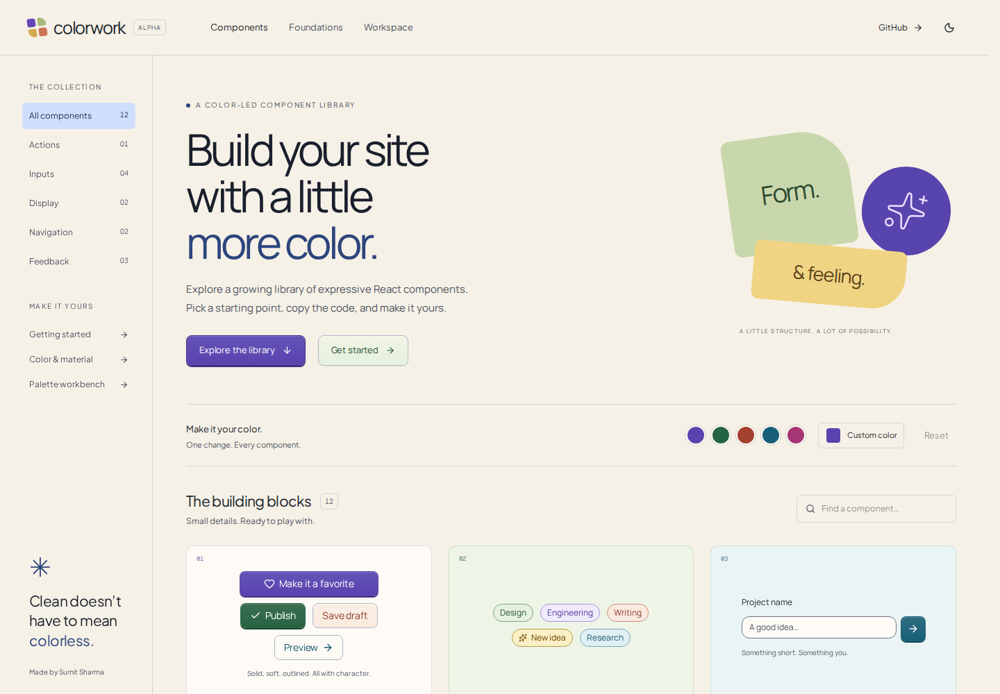
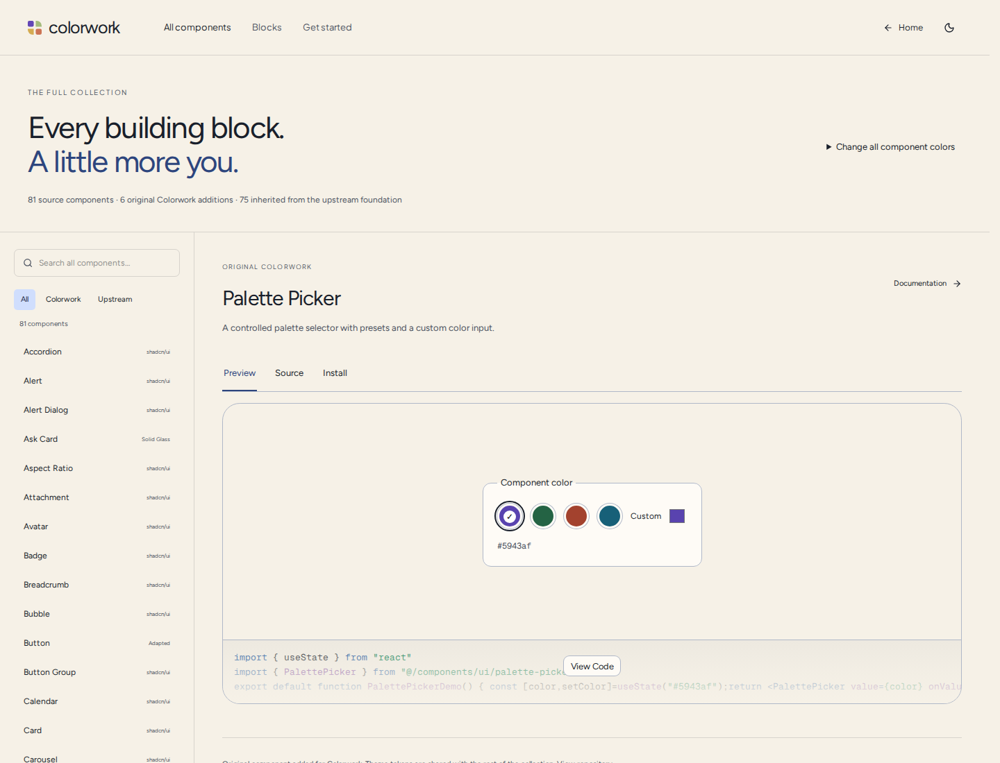

# Colorwork

Every component. One library. Any material.

A free React component library by Sumit Sharma: UI components, AI & voice components and animated icons in one place, each in four materials (Normal, Glass, Frost and Aurora). Copy a component, install it with one command, or hand the registry to your coding agent. **Working name; availability unchecked. Alpha, not a stable release.**

## What's inside

- **UI components**: the full shadcn/ui + Solid Glass set, restyled, with Colorwork originals (Tone Badge, Color Surface, Palette Picker, Option Card, Status Callout, Copy Snippet).
- **AI & voice**: Voice Orb, Live Transcript (in-browser speech to text), Voice Input (press to talk), Audio Waveform (live microphone levels), Streaming Text with Shimmer Text, and Speak Button (text to speech), alongside the inherited agent UI: Composer, Reasoning, Tool Steps, Turn Status and more.
- **Animated icons**: a small, hand-picked set of 21 icons that move like what they stand for. They play on hover, on a loop, or switch between two states (copy → check, menu → close, sun → moon, mic recording).
- **Materials**: `data-material="solid" | "glass" | "frost" | "aurora"` on `<html>` or on any element. On `/components`, "Compare" shows Normal and glass side by side.

Built on Solid Glass, shadcn/ui and Base UI. Original LICENSE and NOTICE.md are retained.



## Run

Use Node 22.12+ (CI uses Node 22).

```bash
npm ci
npm run dev
```

Open http://localhost:5191. The homepage shows the four materials, 12 examples, the AI & voice set and the animated icons. `/components` contains the full component browser, filterable by AI & Voice, Icons, Materials, Originals and Inherited, with example selection, full source and install commands; `/docs/installation` explains copy-in setup and branch-pinned registry commands. `/color-study` keeps the earlier palette workbench; `/view/agent-workspace` is the local-state demo screen.

## Check and build

```bash
npm run docs
npm run typecheck
node --test scripts/block-metadata.test.mjs
npm run build
npm run preview
```

Stop dev before preview; both use port 5191. Build output is `dist/`. Use a static host with SPA fallback for nested routes. GitHub Pages is configured for `https://sumitttt4.github.io/solid-glass`, but is not live until enabled and deployed. `SOLID_GLASS_BASE` and `SOLID_GLASS_ORIGIN` remain as compatible environment variable names for other hosts.

## Reuse

Copy `src/colorwork.css`, `src/materials.css` and `src/solid-glass.css` together; import colorwork.css, then materials.css, after your Tailwind/shadcn styles. The source uses React 19, Tailwind 4, Base UI with Figtree and Plus Jakarta Sans. Copy TSX plus helpers/dependencies when using the new ToneBadge and ColorSurface components.

Registry:

```bash
npx shadcn@latest add sumitttt4/solid-glass/colorwork#main
npx shadcn@latest add sumitttt4/solid-glass/tone-badge#main
```

Do not use the upstream install command for this theme. See the installation docs for current compatibility limits. Demo actions run in memory; they do not imply a working backend.

## Provenance

Derived from [deeplethe/solid-glass](https://github.com/deeplethe/solid-glass) under MIT; upstream shadcn material is covered by NOTICE.md. Original theme, catalog and color components are additions to that foundation. Keep all relevant notices with redistributed source.



## Original additions

Palette Picker, Option Card, Status Callout and Copy Snippet join Tone Badge and Color Surface, with the AI & voice components, Animated Icons and Material Picker. Animated icon path data is from Lucide (ISC). All inherited UI source files, 456 upstream examples and 59 upstream block files are retained. See docs/upstream-inventory.md for provenance and docs/colorwork-verification.md for checks and limits.
